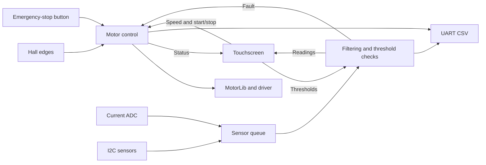

# Embedded EV Motor Control

BLDC motor-control firmware for the TI TM4C1294 LaunchPad, written in C with FreeRTOS. It brings motor control, sensor acquisition and a touchscreen dashboard onto one board.

The motor runs from Hall feedback with a PI speed controller and a ramp-limited reference. Separate tasks handle power sensing, environmental sensors, fault detection, display updates and UART telemetry. A distance or power-limit trip brakes the motor and latches the fault until it is acknowledged.

## What it does

- Controls speed from 250 to 1500 RPM, with Hall-based commutation, a timed startup sequence and a 500 RPM/s reference ramp.
- Samples motor current on a 5 ms task schedule, keeping power acquisition separate from the touchscreen ADC path.
- Reads OPT3001 ambient light, SHT31 temperature/humidity and VL53L0X distance sensors over I2C. Moving-average and median filters keep the plotted signals readable; distance trips use a separate confirmation filter.
- Provides four touchscreen pages: motor control, threshold setup, live plots and a seven-entry fault history.
- Handles manual emergency stops, startup timeouts, power limits and distance limits through the motor state machine.
- Streams desired, reference and measured speed alongside raw and filtered sensor values as 16-column CSV over UART.

## Hardware

The current target is an **EK-TM4C1294XL LaunchPad** at 120 MHz, with a Kentec 320 x 240 touchscreen, a DRV832x motor-driver board and a Hall-sensored BLDC motor. MotorLib supplies the low-level phase-drive interface.

The pin assignments, sensor connections and motor-specific settings are in [hardware notes](docs/hardware.md). This is a bench prototype: the gains, current conversion and motor pole-pair count need to match the connected hardware.

## Build and run

Install [PlatformIO Core](https://docs.platformio.org/en/latest/core/installation/index.html) or the PlatformIO extension for VS Code, then build from the repository root:

```sh
git clone https://github.com/13bad37/Embedded-Control-System-EV.git
cd Embedded-Control-System-EV
pio run
```

The repository includes the TivaWare tree, FreeRTOS sources and MotorLib archive used by the build. PlatformIO installs the ARM toolchain. No external SDK path is needed.

With the LaunchPad connected through its ICDI USB interface:

```sh
pio run --target upload
pio device monitor --baud 115200
```

`pio run` writes the ELF and binary to `.pio/build/lptm4c1294ncpdt/`. Uploading requires the board; compilation and the host tests do not.

The touchscreen selects the requested speed and sensor thresholds. PJ0 triggers the manual emergency stop; PJ1 acknowledges a latched fault. Acknowledgement returns the controller to Idle. A live power or distance hazard still blocks the next start.

## Inside the firmware



[Architecture](docs/architecture.md) covers task timing, control states and the fault path. [Project structure](docs/project-structure.md) maps those parts to the source files.

The display clock uses the build date and a fixed 11:15 AM starting time, then advances from RTOS ticks. Fault history is held in RAM. Neither persists across a reset.

## Tests

Run the existing regression tests with Python 3 and a host C compiler:

```sh
python3 scripts/test_host.py
```

They cover emergency-stop behaviour, VL53L0X initialisation, clock rollover and fault-history ordering. See [test notes](test/README.md) for the scope and the distinction between mocked tests and checks on the board.

The UART output mixes diagnostic messages with CSV rows. Filter for numeric 16-column rows when importing a capture into a plotter; the field order is documented in [architecture](docs/architecture.md#uart-telemetry).

The bundled libraries and drivers retain their original attribution. See [library notes](lib/README.md) for how they fit into the build.
