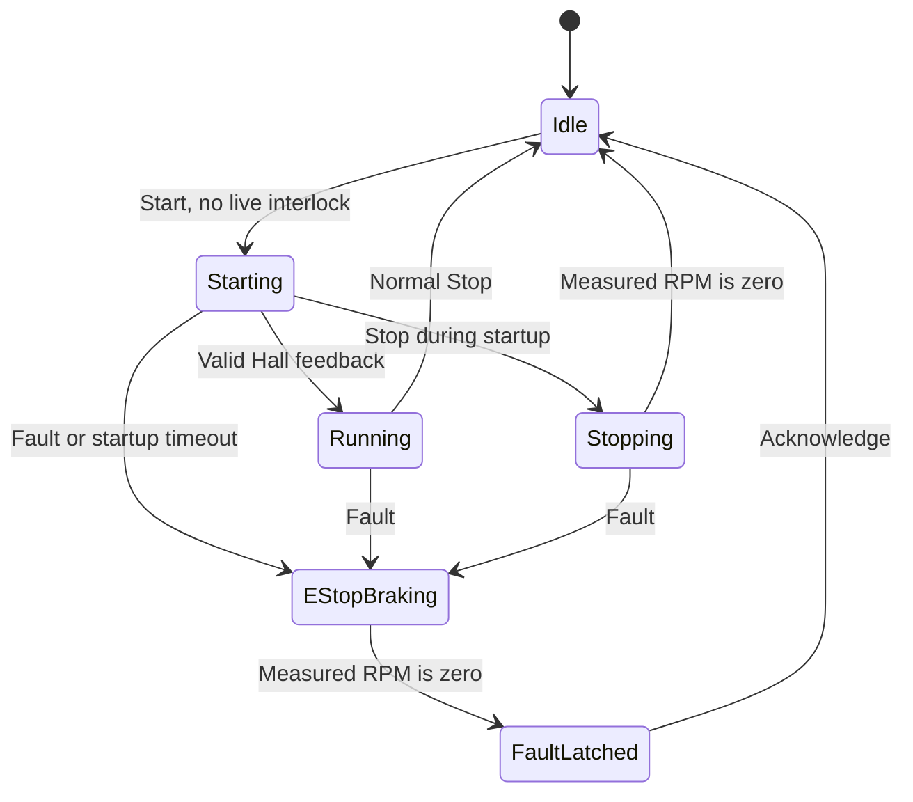

# Firmware architecture

## Tasks and timing

The periods below are configured delays, not measured worst-case execution times. Motor control has priority 3, sensor and fault tasks priority 2, and display, integration and telemetry tasks priority 1.

| Task | Schedule | Work |
| --- | --- | --- |
| Motor | 10 ms delay per iteration | Apply live interlocks, consume emergency-stop signals, advance the motor state machine and update speed control |
| Sensor | 5 ms periodic wake | Sample the current channels, drain the sample queue, update filters and check thresholds |
| Environment | 20 ms delay per iteration | Poll the distance sensor and service the slower light and temperature/humidity reads |
| GUI | 50 ms delay per iteration | Refresh dashboard state and notify the display task |
| Fault | 50 ms delay per iteration | Read the emergency-stop and acknowledgement buttons |
| Integration | 25 ms delay per iteration | Reserved integration hook; currently no additional processing |
| Telemetry | 10 ms delay per iteration | Write one CSV frame |

The dashboard creates a separate display task to process touch requests and repaint widgets. A short-lived sensor-initialisation task brings up the I2C devices. Slow environmental reads are kept out of the faster power-sampling loop.

## Motor control

Hall edges update commutation and capture a timer interval for RPM estimation. The conversion uses `PROJECT_MOTOR_POLE_PAIRS`; the default is seven. With no recent Hall edge, the measured speed returns to zero.

Startup increases duty in timed steps and waits for valid Hall feedback. It times out after 3 seconds. Once running, a feed-forward term and PI correction regulate speed against a ramp-limited reference. The normal reference ramp is 500 RPM/s; the emergency reference ramp is 1000 RPM/s.

The duty values passed to MotorLib are pulse widths in microseconds within a 50 microsecond PWM period. The `pwm_duty_per_mille` field keeps an older name; it does not contain a per-mille duty value.



Emergency braking disables commutation, sets forward PWM to zero and calls MotorLib's hard-brake function. The falling reference is retained for reporting; it must not overwrite the brake with a forward-drive command. Normal Stop while Running disables outputs immediately. Stop during Starting follows the separate Stopping state.

## Sensor and fault path

Current readings and I2C samples enter a typed FreeRTOS queue. The sensor manager drains the queue and updates only the filters with fresh input. Light, temperature, humidity, speed and power use moving averages; the displayed distance uses a five-sample median.

Distance protection is separate from the graph filter. Two fresh readings below the configured distance threshold confirm a hazard. A fresh clear reading releases the live interlock, while an already-latched motor fault still needs acknowledgement. Power-limit violations also raise an emergency stop. Manual emergency stop takes precedence in the motor task.

The distance and light devices retry initialisation after a failed attempt. Until a valid distance reading arrives, the distance input does not assert a hazard. Sensor-loss fail-safe handling would need additional work before using this outside the bench setup.

The emergency-stop semaphore carries the notification and a separate field retains its cause. The motor task also checks live hazards each iteration so a fault raised while Idle cannot be bypassed by the next Start request. The general event queue remains available but is not the primary control path.

## Dashboard

The four pages are Motor, Setup, Plots and Faults. Setup changes the requested speed, maximum motor power, minimum clearance and temperature thresholds. Plots compare live values with targets or limits where applicable. Ambient light below 5 lux turns on the day/night indicator after the first valid reading.

Fault history stores the seven newest fault episodes in RAM and records each episode once. The clock starts at 11:15 AM on the build date and advances with scheduler ticks. It is a software display clock, not an RTC or a synchronised timestamp source.

## UART telemetry

UART0 runs at 115200 baud. Each numeric frame has 16 CSV columns, in this order:

```text
desired_rpm,reference_rpm,actual_rpm,duty_us,
light_raw,light_filtered,temp_raw,temp_filtered,
humidity_raw,humidity_filtered,distance_raw_mm,distance_filtered_mm,
speed_raw_rpm,speed_filtered_rpm,power_raw_w,power_filtered_w
```

The line above is wrapped for readability; the firmware emits all 16 values on one line. Temperature and humidity currently enter the queue as whole-number Celsius and relative-humidity values, despite legacy `_x10` names in the filtered-data structure. Diagnostic messages share the port, so a capture must discard non-CSV lines before plotting.
